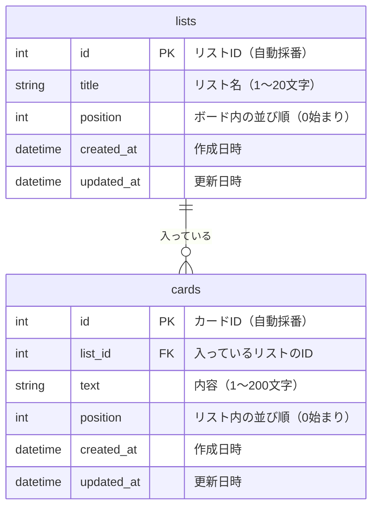

# タスク管理アプリ 要件定義書

## 0. 文書情報

| 項目 | 内容 |
| --- | --- |
| 文書名 | タスク管理アプリ 要件定義書 |
| 版 | v1.2 |
| 最終更新日 | 2026-11-17 |
| 発注者 | のん |
| 開発者 | のん |

本課題では、発注者と開発者を自分ひとりで兼ねます。ただし文書を書くときは、「お願いする側（発注者）」と「作る側（開発者）」の立場を分けて考えます。

### 改訂履歴

| 版 | 日付 | 内容 |
| --- | --- | --- |
| v1.0 | 2026-11-15 | 初版 |
| v1.1 | 2026-11-17 | 前提条件・制約条件、用語集、ユースケース、受入基準、リスク、未決事項を追加。非機能要件と技術選定を詳しくした。保存データに版番号を追加。動作環境にFirefoxを追加 |
| v1.2 | 2026-11-17 | フェーズ2（バックエンド＋データベース）を追加し、システム構成、ER図、テーブル定義、API設計、運用を追加。画面一覧を追加。Firefoxを動作環境から外した |

### 承認

| 立場 | 氏名 | 承認日 |
| --- | --- | --- |
| 発注者 | のん | |
| 開発者 | のん | |

### 記号の意味

| 記号 | 英語 | 意味 |
| --- | --- | --- |
| P | Precondition | 前提条件 |
| C | Constraint | 制約条件 |
| UC | Use Case | ユースケース |
| SC | Screen | 画面 |
| DL | Dialog | 確認画面（ダイアログ） |
| F | Functional requirement | 機能要件 |
| NFR | Non-Functional Requirement | 非機能要件 |
| AT | Acceptance Test | 受入テスト |
| R | Risk | リスク |
| Q | Question | 未決事項 |

## 1. 概要

リストとカードでタスクを管理する、Trello風のシンプルなWebアプリを作ります。

- **目的**: タスクを「ToDo / 進行中 / 完了」などの列で見える化し、状況をひと目で把握できるようにする
- **背景**: AIエンジニアコースの課題として、要件定義から実装、データベースを使った運用までの流れを一通り体験する
- **対象ユーザー**: 自分ひとり（個人のタスク管理）。ログインや共有は想定しない

### 1.1 進め方（2つのフェーズ）

一度に全部を作らず、2段階で進めます。画面と操作はどちらのフェーズでも同じで、**データの保存先だけが変わります**。

| フェーズ | 保存先 | 開き方 | ゴール |
| --- | --- | --- | --- |
| フェーズ1 | ブラウザ（localStorage） | index.html をダブルクリック | 画面と操作を完成させる |
| フェーズ2 | データベース（バックエンド経由） | サーバーを起動して `http://localhost:（番号）` を開く | 保存先をデータベースに切り替え、日々の運用（起動・バックアップ）ができる |

フェーズ1を先に完成させることで、早く動くものができます。また、「保存先だけを差し替えられる作り」にする練習にもなります。

## 2. スコープ

| 区分 | 内容 |
| --- | --- |
| 作る（フェーズ1） | ボード1枚、リストの追加・名前変更・削除、カードの追加・編集・削除、カードのドラッグ&ドロップ移動・並べ替え、ブラウザへの自動保存 |
| 作る（フェーズ2） | バックエンド（API）、データベース、保存先のデータベースへの切り替え、運用手順（起動・停止・バックアップ・障害時の対応） |
| 作らない | ログイン、マルチユーザー（複数人での利用・共有・同時編集）、複数ボード、期限・ラベル・担当者、リスト自体の並べ替え、元に戻す、画面からのバックアップ機能、キーボードだけでのカード移動、スマートフォン表示、インターネットへの公開、フェーズ1のデータのフェーズ2への引き継ぎ |
| 今回の文書で扱わない | 納期、費用、保守（課題のため） |

## 3. 前提条件・制約条件

**前提条件**は「これが成り立っている前提で作る」こと、**制約条件**は「変えられない制限」です。前提が崩れたときに起きる問題は、16章「リスクと対応」で扱います。

### 3.1 前提条件

| No | フェーズ | 内容 |
| --- | --- | --- |
| P-01 | 共通 | 利用者は自分ひとりで、1台のパソコンで使う |
| P-02 | 共通 | ブラウザは Chrome か Edge のどちらか1つに決めて使い続ける |
| P-03 | 共通 | 1つのタブで使う |
| P-04 | 1 | アプリのフォルダをパソコンに置き、index.html をダブルクリックして開く（11.2） |
| P-05 | 1 | ブラウザの閲覧データ（サイトデータ）を削除しない |
| P-06 | 2 | 使う前に、自分でサーバーを起動する（12.1） |

### 3.2 制約条件

| No | フェーズ | 内容 | 理由 |
| --- | --- | --- | --- |
| C-01 | 共通 | フレームワーク（Reactなど）を画面側に使わない | Webの基礎を学ぶため |
| C-02 | 共通 | 外部のサイト（CDNなど）からファイルを読み込まない | ネットにつながっていなくても動かすため |
| C-03 | 共通 | 自分のパソコンの中だけで動かし、インターネットには公開しない | ログイン機能を作らないため（公開すると誰でも見られてしまう） |
| C-04 | 1 | サーバー・データベースを使わない | フェーズ1は画面と操作の完成に集中するため |
| C-05 | 1 | JavaScriptは`<script>`タグで読み込み、モジュール機能（`type="module"`）は使わない | ダブルクリックで開いたページでは、ブラウザの安全機能によりモジュールが読み込めないため |

## 4. 用語集

| 用語 | 意味 |
| --- | --- |
| ボード | アプリの画面全体。リストを並べる台 |
| リスト | 「ToDo」「進行中」などの列。カードを縦に並べる |
| カード | タスク1件。文字だけを持つ |
| 確定 | 入力した内容を反映すること。Enterキー、または入力欄の外をクリック |
| ドラッグ&ドロップ | カードをマウスでつかんで動かし、離して置く操作 |
| localStorage | ブラウザの中にデータを保存する仕組み。ブラウザを閉じても消えない |
| オリジン | ブラウザがデータを分けて保存するときの「住所」。開き方（ダブルクリック／サーバー経由）が違うと別の住所になる |
| フロントエンド | ブラウザで動く部分（画面）。index.html・style.css・script.js |
| バックエンド | サーバーで動く部分。画面からの依頼を受けて、データベースを読み書きする |
| API | 画面とバックエンドがやりとりする窓口。「このURLにこの形のデータを送ると、こうなる」という約束 |
| データベース（DB） | データを表（テーブル）の形で保存する仕組み |
| テーブル | データベースの中の表。1行が1件のデータ |
| ER図 | テーブルと、テーブル同士のつながりを表した図 |
| localhost | 自分のパソコン自身を指す名前。`http://localhost:8000` は「自分のパソコンの8000番の窓口」という意味 |
| ポート | パソコンの中の窓口の番号。8000、8080など |
| トランザクション | 複数の書き込みを「全部成功」か「全部なかったことにする」のどちらかにする仕組み |

## 5. ユースケース

利用者（自分）が「何のために、どの順番で操作するか」をまとめます。UC-01〜05はフェーズ1・2で共通、UC-06はフェーズ2だけのものです。

### 5.1 利用シナリオ

朝、パソコンでボードを開き（フェーズ2ではサーバーを起動してから開く：UC-06）、今日やることを「ToDo」に書き出す（UC-01）。作業を始めたらカードを「進行中」へ、終わったら「完了」へ動かす（UC-02）。途中で内容が変わったら書き直す（UC-03）。週末に「完了」のカードを片付ける（UC-04）。使っているうちに列が足りなければ「保留」などのリストを足す（UC-05）。

### 5.2 ユースケース一覧

| ID | ユースケース | 関係する機能 |
| --- | --- | --- |
| UC-01 | タスクを登録する | F-05、F-10 |
| UC-02 | タスクの進み具合を更新する | F-08、F-09、F-10 |
| UC-03 | タスクの内容を直す | F-06、F-10 |
| UC-04 | 終わったタスクを片付ける | F-07、F-10 |
| UC-05 | ボードの列を自分用に整える | F-02、F-03、F-04、F-10 |
| UC-06 | アプリを起動する・終了する（フェーズ2） | 12章「運用」 |

### 5.3 ユースケースの詳細

**UC-01：タスクを登録する**
- 目的：やることを忘れないように書き出す
- 開始条件：ボードが表示されている
- 基本フロー
  1. 登録したいリストの「+ カードを追加」を押す
  2. タスクの内容を入力し、Enterキーを押す
  3. カードがリストの一番下に追加され、自動で保存される
  4. 入力欄は開いたままなので、続けて2〜3を繰り返す
  5. Escキーを押して入力を終える
- 代替フロー
  - 2で何も入力せずにEnter → 何も追加されない
  - 2で200文字を超えて入力 → 200文字までしか入らない
  - 3で保存に失敗（フェーズ2でサーバーが止まっているなど） → 画面右上に赤い文字でメッセージが出る

**UC-02：タスクの進み具合を更新する**
- 目的：作業の状況に合わせてカードを動かす
- 開始条件：動かしたいカードがある
- 基本フロー
  1. カードをつかむ（つかんでいるカードは半透明になる）
  2. 移動先のリストの、置きたい位置まで動かす（置く位置に線が出る）
  3. 離すと、カードがその位置に移り、自動で保存される
- 代替フロー
  - 3でリストの外で離した → カードは元の位置に戻る
  - 移動先のリストが空 → 空のリストにも置ける
  - 同じリスト内で動かした → 順番が入れ替わる（優先順位の並べ替え）

**UC-03：タスクの内容を直す**
- 目的：書き間違いや内容の変更を反映する
- 開始条件：直したいカードがある
- 基本フロー
  1. カードをダブルクリックする
  2. その場で入力欄に変わるので、書き換えてEnterキーを押す
  3. 内容が変わり、自動で保存される
- 代替フロー
  - 2でEscキー → 元の内容に戻る
  - 2で全部消してEnter → 何も言わずに元の内容に戻る

**UC-04：終わったタスクを片付ける**
- 目的：不要になったカードを消して、ボードを見やすく保つ
- 開始条件：消したいカードがある
- 基本フロー
  1. カードにマウスを乗せる（右上に「×」が出る）
  2. 「×」を押す
  3. 確認なしですぐ消え、自動で保存される
- 備考：元に戻す機能はない（今後の拡張案1）

**UC-05：ボードの列を自分用に整える**
- 目的：作業のやり方に合わせて、リストを増やす・名前を変える・消す
- 開始条件：ボードが表示されている
- 基本フロー（追加）
  1. 「+ リストを追加」を押し、名前を入力してEnterキーを押す
  2. 一番最後にリストが追加され、自動で保存される
- 基本フロー（名前変更）
  1. リスト名をクリックし、書き換えてEnterキーを押す
- 基本フロー（削除）
  1. リスト名の右の「×」を押す
  2. カードが入っているときは確認画面が出るので、OKを押す
- 代替フロー
  - 削除の確認画面でキャンセル → リストもカードも残る
  - 空のリストの「×」 → 確認なしですぐ消える

**UC-06：アプリを起動する・終了する（フェーズ2）**
- 目的：アプリを使い始める、使い終える
- 開始条件：パソコンが起動している
- 基本フロー
  1. ターミナルを開き、起動コマンドを入力してサーバーを起動する（12.1）
  2. ブラウザで `http://localhost:（番号）` を開く
  3. 前回の続きのボードが表示される
  4. 使い終わったら、ターミナルで Ctrl+C を押してサーバーを止める
- 代替フロー
  - 1を忘れて2を開いた → ブラウザに「このサイトにアクセスできません」と出る。1からやり直す
  - サーバーを止めずにパソコンを終了した → 問題ない（保存は操作のたびに終わっているため）

## 6. 機能要件

機能は全部で10個です。各フェーズで、優先度「高」の8個がすべて動けば完成とします（詳しくは14章「受入基準」）。機能はフェーズ1・2で共通です。

| ID | 対象 | 機能 | 説明 | 優先度 |
| --- | --- | --- | --- | --- |
| F-01 | リスト | 表示 | リストを横に並べて表示する。入りきらない分は下の段へ折り返す | 高 |
| F-02 | リスト | 追加 | 名前を入力して、新しいリストを一番最後に追加する | 高 |
| F-03 | リスト | 名前変更 | リスト名をクリックして書き換える | 中 |
| F-04 | リスト | 削除 | 「×」を押し、確認後にリストと中のカードを削除する | 中 |
| F-05 | カード | 追加 | 各リストの下の入力欄から、カードを一番下に追加する | 高 |
| F-06 | カード | 編集 | カードをダブルクリックして書き換える | 高 |
| F-07 | カード | 削除 | マウスを乗せると出る「×」で、確認なしで削除する | 高 |
| F-08 | カード | 移動 | ドラッグ&ドロップで、別のリストの好きな位置へ移す | 高 |
| F-09 | カード | 並べ替え | ドラッグ&ドロップで、同じリスト内の順番を入れ替える | 高 |
| F-10 | 共通 | 保存 | 操作のたびに自動保存し、ブラウザを閉じても同じ状態を表示する | 高 |

### 6.1 共通ルール

追加と変更でルールがそろうように、次のルールをすべての入力欄に当てはめます。

| ルール | リスト名 | カード |
| --- | --- | --- |
| 文字数の上限 | 20文字 | 200文字 |
| 空欄 | 追加できない | 追加できない |
| 同じ内容 | OK | OK |
| 改行 | できない | できない |
| 確定 | Enterキー、または入力欄の外をクリック | Enterキー、または入力欄の外をクリック |
| やめる | Escキー | Escキー |

### 6.2 各機能の詳細

**F-01：リストの表示**
- 初めて開いたときは「ToDo」「進行中」「完了」の3つのリストを表示する
- サンプルのカードは入れない（最初はカードなし）
- 画面の幅に入りきらないリストは下の段へ折り返し、画面は下にスクロールする

**F-02：リストの追加**
- リストの並びの最後にある「+ リストを追加」を押すと、入力欄が出る
- 確定すると、新しいリストを一番最後に追加する
- Escキー、または入力欄の外をクリックすると、追加をやめる
- リストの数に上限はない

**F-03：リストの名前変更**
- リスト名をクリックすると、その場で入力欄に変わる
- Escキーを押すと、元の名前に戻す
- 全部消して確定したときは、何も言わずに元の名前に戻す
- 最初からある3つのリストも、ほかのリストと同じく名前を変えられる

**F-04：リストの削除**
- リスト名の右の「×」を押すと削除する
- カードが入っているときは、ブラウザ標準の確認画面を出す。文面にはリスト名とカードの枚数を入れる（例：「『ToDo』を削除しますか？中のカード3枚も削除されます」）
- 空のリストは、確認なしですぐ削除する
- リストが全部なくなってもよい（「+ リストを追加」だけが残る）

**F-05：カードの追加**
- リストの一番下の「+ カードを追加」を押すと、入力欄が出る
- 確定すると、カードをリストの一番下に追加する
- 追加したあとも入力欄を開いたままにし、続けて入力できる
- Escキー、または入力欄の外をクリックすると、入力をやめる

**F-06：カードの編集**
- カードをダブルクリックすると、その場で入力欄に変わる（クリック1回にしないのは、ドラッグ操作と区別するため）
- Escキーを押すと、元の内容に戻す
- 全部消して確定したときは、何も言わずに元の内容に戻す（削除は「×」ボタンだけで行う）

**F-07：カードの削除**
- カードにマウスを乗せたときだけ、右上に「×」を表示する
- 「×」を押すと、確認なしですぐ削除する

**F-08：カードの移動**
- カードをつかんで、別のリストのカードとカードの間など、好きな位置に置ける
- カードが1枚もないリストにも置ける
- つかんでいる間は、カードを半透明にし、置く位置に線を表示する
- リストの外で離したときは、元の場所に戻す

**F-09：カードの並べ替え**
- F-08と同じ操作と見た目で、同じリスト内の順番を入れ替える

**F-10：保存**
- 追加・編集・削除・移動のたびに自動で保存する（「保存」ボタンはない）
- ブラウザを閉じても、パソコンを再起動しても、次に開いたときに同じ状態を表示する
- 初めて使うときは、最初の3つのリストの状態から始める
- フェーズ1の保存のしかたは9.1、フェーズ2は9.2と10章に従う

## 7. 画面設計

### 7.1 画面一覧

画面はボード画面1つだけです。入力欄やメッセージは、別の画面に切り替えずにボード画面の中で表示します。

| ID | 名前 | 種類 | 表示するタイミング | 関係する機能・ユースケース |
| --- | --- | --- | --- | --- |
| SC-01 | ボード画面 | 画面 | アプリを開いたとき（唯一の画面） | F-01〜F-10、UC-01〜05 |
| SC-01-a | リスト名の入力欄 | ボード画面の中の部品 | 「+ リストを追加」やリスト名を押したとき | F-02、F-03、UC-05 |
| SC-01-b | カードの入力欄 | ボード画面の中の部品 | 「+ カードを追加」を押したとき、カードをダブルクリックしたとき | F-05、F-06、UC-01、UC-03 |
| SC-01-c | 保存エラーの表示 | ボード画面の中の部品（右上） | 保存に失敗したとき | F-10、NFR-14 |
| DL-01 | リスト削除の確認 | ブラウザ標準の確認画面 | カードが入ったリストの「×」を押したとき | F-04、UC-05 |

### 7.2 ボード画面（SC-01）のレイアウト

上部にボード名、その下にリストが横に並びます。入りきらないリストは下の段へ折り返します。

```
┌───────────────────────────────────────────────────────────────┐
│ マイボード                                      変更は自動保存 │
└───────────────────────────────────────────────────────────────┘
┌──────────────┐ ┌──────────────┐ ┌──────────────┐ ┌ ─ ─ ─ ─ ─ ─ ┐
│ ToDo       × │ │ 進行中     × │ │ 完了       × │   + リストを追加
│┌────────────┐│ │┌────────────┐│ │┌────────────┐│ └ ─ ─ ─ ─ ─ ─ ┘
││要件定義を書く││ ││環境を用意  ││ ││課題を確認  ││
│└────────────┘│ │└────────────┘│ │└────────────┘│
│┌────────────┐│ │┌ ─ ─ ─ ─ ─ ┐│ │              │
││画面を作る  ├──→ ここへドロップ │ │              │
│└────────────┘│ │└ ─ ─ ─ ─ ─ ┘│ │              │
│              │ │              │ │              │
│+ カードを追加│ │+ カードを追加│ │+ カードを追加│
└──────────────┘ └──────────────┘ └──────────────┘
```

※ 図のカードは操作のイメージを示す例です。実際には、初めて開いたときにカードは入っていません。

右上の「変更は自動保存」は、保存に失敗したときだけ、赤い文字のメッセージに変わります。

| フェーズ | 失敗の例 | メッセージ |
| --- | --- | --- |
| 1 | 容量がいっぱい | 保存できませんでした（容量がいっぱいの可能性があります） |
| 2 | サーバーが止まっている、エラーが起きた | 保存できませんでした（サーバーに接続できません） |

| 操作 | やり方 |
| --- | --- |
| カードを追加 | リスト下の「+ カードを追加」を押し、文字を入力してEnter |
| カードを編集 | カードをダブルクリックして文字を書き換え、Enter |
| カードを削除 | カードにマウスを乗せると出る「×」を押す |
| カードを移動・並べ替え | カードをつかんで、置きたい位置で離す |
| リストを追加 | 右端の「+ リストを追加」を押し、名前を入力してEnter |
| リスト名を変更 | リスト名をクリックして書き換え、Enter |
| リストを削除 | リスト名の右の「×」を押す（カードがあるときは確認でOK） |

## 8. システム構成

### 8.1 フェーズ1

```
┌──────────── 自分のパソコン ────────────┐
│  ブラウザ                               │
│  ┌──────────────┐    ┌──────────────┐  │
│  │ 画面          │───→│ localStorage │  │
│  │ (HTML/CSS/JS) │←───│              │  │
│  └──────────────┘    └──────────────┘  │
└────────────────────────────────────────┘
```

### 8.2 フェーズ2

```
┌─────────────────────────── 自分のパソコン ───────────────────────────┐
│  ブラウザ                    バックエンド              データベース      │
│  ┌──────────────┐  API   ┌──────────────┐  SQL   ┌──────────────┐   │
│  │ 画面          │──────→│ サーバー       │──────→│ lists        │   │
│  │ (HTML/CSS/JS) │←──────│ (言語はQ-01)   │←──────│ cards        │   │
│  └──────────────┘  JSON  └──────────────┘        └──────────────┘   │
│      http://localhost:（番号）                                         │
└──────────────────────────────────────────────────────────────────────┘
```

- バックエンドは、APIのほかに画面のファイル（index.html など）も配る。画面とAPIが同じ住所（オリジン）になるので、余計な設定がいらない
- バックエンドは、自分のパソコンからの接続だけを受け付ける（NFR-21）

## 9. データ設計

### 9.1 フェーズ1：localStorage

ボードの中にリストの配列、各リストの中にカードの配列を持つ入れ子構造にします。配列の順番がそのまま画面の並び順になります。

| データ | 項目 | 型 | 説明 |
| --- | --- | --- | --- |
| ボード | version | 数値 | 保存データの形式の版。今回は `1` |
| ボード | lists | 配列 | リストの一覧（並び順どおり） |
| リスト | id | 文字列 | リストを区別するID |
| リスト | title | 文字列 | リスト名（20文字まで） |
| リスト | cards | 配列 | カードの一覧（上から順に） |
| カード | id | 文字列 | カードを区別するID |
| カード | text | 文字列 | タスクの内容（200文字まで） |

データを丸ごとJSON文字列にして、localStorageの `taskBoard` という名前で保存します。初めて開いたときのデータは次のとおりです。

```json
{
  "version": 1,
  "lists": [
    { "id": "l1", "title": "ToDo", "cards": [] },
    { "id": "l2", "title": "進行中", "cards": [] },
    { "id": "l3", "title": "完了", "cards": [] }
  ]
}
```

- **版番号**：`version` は、将来カードに期限やラベルを追加したときに、古い形式のデータを見分けて変換するために持つ
- **容量**：localStorageに保存できる量は、およそ5MBまで。カード1枚は最大でも1KB程度なので、想定する上限の1,000枚でも1MB程度に収まる。保存に失敗したときは画面にメッセージを出す
- **壊れたデータ**：保存データが壊れていて読み込めないときは、壊れたデータを `taskBoard_broken` という別の名前で残してから、最初の3つのリストの状態で始める。そのまま初期状態で始めると、次の保存で壊れたデータが上書きされ、あとから調べたり手で直したりできなくなるため

### 9.2 フェーズ2：データベース

リストとカードを、それぞれ別のテーブルに保存します。カードは「どのリストに入っているか」を `list_id` で持ちます。並び順は `position`（0から始まる番号）で持ちます。

#### ER図



図の読み方：`||--o{` は「リスト1つに対して、カードが0枚以上」という意味です。PKは主キー（行を区別する番号）、FKは外部キー（ほかのテーブルの行を指す番号）です。

ボードは1枚だけ（複数ボードは作らない）なので、ボードのテーブルは作りません。

#### テーブル定義

**lists（リスト）**

| 列 | 型 | 必須 | 制約・説明 |
| --- | --- | --- | --- |
| id | 整数 | ○ | 主キー。自動で番号を振る |
| title | 文字列 | ○ | 1〜20文字 |
| position | 整数 | ○ | ボード内の並び順。0から始まる |
| created_at | 日時 | ○ | 作成した日時。自動で入れる |
| updated_at | 日時 | ○ | 最後に変更した日時。自動で入れる |

**cards（カード）**

| 列 | 型 | 必須 | 制約・説明 |
| --- | --- | --- | --- |
| id | 整数 | ○ | 主キー。自動で番号を振る |
| list_id | 整数 | ○ | 外部キー（lists.id）。**リストを削除すると、中のカードも一緒に削除する**（F-04） |
| text | 文字列 | ○ | 1〜200文字 |
| position | 整数 | ○ | リスト内の並び順。0から始まる |
| created_at | 日時 | ○ | 作成した日時。自動で入れる |
| updated_at | 日時 | ○ | 最後に変更した日時。自動で入れる |

#### 初期データ

テーブルを**最初に作ったときだけ**、「ToDo」「進行中」「完了」の3つのリストを入れます。

「リストが0件なら3つ入れる」という作りにはしません。F-04でリストを全部消してよいことにしているため、そうすると、全部消して再起動したときに3つのリストが勝手に復活してしまいます。

#### 並び順の更新

カードを移動したときは、移動元と移動先のリストのカードについて `position` を振り直します。途中で失敗して並び順が中途半端にならないよう、まとめて1つのトランザクションで行います。

### 9.3 フェーズ1からフェーズ2へのデータ移行

**移行しません。** フェーズ2は、最初の3つのリストの状態から始めます。

理由：フェーズ1（ダブルクリックで開く）とフェーズ2（`http://localhost` で開く）ではオリジンが違うため、フェーズ2の画面からフェーズ1のlocalStorageを読むことができません（11.2）。移行するには、データをファイルに書き出して読み込む機能が別に必要になり、今回の範囲を超えます。

## 10. API設計（フェーズ2）

画面とバックエンドは、JSON形式でやりとりします。名前の付け方は、APIでは `listId` のようなキャメルケース、データベースでは `list_id` のようなスネークケースにします。

| No | メソッド | URL | 用途 | 送るデータ | 成功時の返事 |
| --- | --- | --- | --- | --- | --- |
| API-01 | GET | `/api/board` | ボード全体を読み込む | なし | 200：ボード全体（下の例） |
| API-02 | POST | `/api/lists` | リストを追加する | `{"title": "保留"}` | 201：追加したリスト |
| API-03 | PATCH | `/api/lists/{id}` | リスト名を変更する | `{"title": "やること"}` | 200：変更後のリスト |
| API-04 | DELETE | `/api/lists/{id}` | リストを削除する（中のカードも） | なし | 204：返事の中身なし |
| API-05 | POST | `/api/lists/{id}/cards` | カードを一番下に追加する | `{"text": "買い物"}` | 201：追加したカード |
| API-06 | PATCH | `/api/cards/{id}` | カードの内容を変更する | `{"text": "買い物に行く"}` | 200：変更後のカード |
| API-07 | DELETE | `/api/cards/{id}` | カードを削除する | なし | 204：返事の中身なし |
| API-08 | PUT | `/api/cards/{id}/position` | カードを移動・並べ替えする | `{"listId": 2, "position": 0}` | 200：移動後のカード |

API-08の `position` は、移動先のリストで上から何番目に置くか（0始まり）です。

**API-01の返事の例**（リストもカードも並び順どおりに並べて返す）

```json
{
  "lists": [
    {
      "id": 1,
      "title": "ToDo",
      "cards": [
        { "id": 10, "text": "要件定義を書く" },
        { "id": 11, "text": "画面を作る" }
      ]
    },
    { "id": 2, "title": "進行中", "cards": [] },
    { "id": 3, "title": "完了", "cards": [] }
  ]
}
```

**エラーの返事**

| 状態コード | どんなとき | 例 |
| --- | --- | --- |
| 400 | 送られたデータがルールに合わない | 空のタイトル、201文字のカード |
| 404 | 指定したリスト・カードがない | 削除済みのカードIDを指定した |
| 500 | サーバーの中で予期しないエラーが起きた | データベースのファイルが読めない |

エラーのときは `{"error": "カードは200文字以内で入力してください"}` のように、理由を返します。

**画面側の扱い**：保存（APIの呼び出し）に失敗したら、画面右上に赤い文字でメッセージを出し、API-01でボードを読み込み直して、データベースの本当の状態を表示します。

## 11. 非機能要件

機能以外の「どのくらいの品質で動くか」を決めます。分類は、現場でよく使われるIPAの「非機能要求グレード」を参考にしています。

### 11.1 一覧

| ID | フェーズ | 分類 | 要件 |
| --- | --- | --- | --- |
| NFR-01 | 共通 | 性能 | カードの追加・編集・削除・移動が、画面にすぐ反映される（目安：フェーズ1は0.1秒以内、フェーズ2は0.2秒以内。カード500枚の状態でも待たされない） |
| NFR-02 | 共通 | 性能 | ページを開いてから1秒以内にボードが表示される |
| NFR-03 | 共通 | 容量 | カード1,000枚まで保存できる |
| NFR-04 | 共通 | 動作環境 | パソコン版の Google Chrome・Microsoft Edge の最新版で動く |
| NFR-05 | 共通 | 動作環境 | 画面の幅1280px以上を基本とし、1024pxでも表示が崩れない |
| NFR-06 | 共通 | 外部依存 | SortableJSはファイルをダウンロードしてフォルダに入れておく（CDNを使わない） |
| NFR-07 | 共通 | セキュリティ | 入力された文字はHTMLとして解釈させず、文字のまま表示する（XSS対策） |
| NFR-08 | 共通 | セキュリティ | データを自分のパソコンの外へ送信しない |
| NFR-09 | 共通 | 使いやすさ | 説明書を読まなくても操作できる。Enterキーで確定、Escキーで取り消しができる |
| NFR-10 | 共通 | 使いやすさ | キーボードで操作しているとき、今どこを操作しているか（フォーカス）が見える |
| NFR-11 | 共通 | 安全性 | カードが入ったリストの削除など、影響の大きい操作の前に確認を出す |
| NFR-12 | 共通 | 保守性 | 「データを変える処理」「画面に表示する処理」「保存する処理」を分けて書く。フェーズ2で保存する処理だけを差し替えられるようにするため |
| NFR-13 | 共通 | 保守性 | 開発ステップ（18章）ごとにGitでコミットする |
| NFR-14 | 共通 | 可用性 | 保存に失敗したときは、画面にメッセージを出す（7章） |
| NFR-15 | 1 | 起動方法 | index.html をダブルクリックして開く。インストール・ネット接続は不要（11.2） |
| NFR-16 | 1 | データ保全 | 壊れた保存データを上書きせずに退避する（9.1） |
| NFR-17 | 1 | 移行性 | 保存データに版番号（version）を持たせる（9.1） |
| NFR-18 | 2 | 起動方法 | コマンド1つでサーバーを起動でき、`http://localhost:（番号）` で開ける（12.1） |
| NFR-19 | 2 | データ保全 | データベースの制約（必須・文字数・外部キー）で、ルールに合わないデータが入らないようにする（9.2） |
| NFR-20 | 2 | データ保全 | カードの移動による並び順の更新は、1つのトランザクションで行う（9.2） |
| NFR-21 | 2 | セキュリティ | サーバーは自分のパソコンからの接続だけを受け付ける。同じWi-Fiにつながったほかの機器からは開けない |
| NFR-22 | 2 | セキュリティ | 入力のチェック（文字数・空欄）は、画面とバックエンドの両方で行う。画面のチェックは、APIを直接呼ばれると素通りされるため |
| NFR-23 | 2 | セキュリティ | SQLは、入力された文字を直接つなげて組み立てず、プレースホルダ（値を入れる穴）を使う（SQLインジェクション対策） |
| NFR-24 | 2 | 運用 | 手順に沿って、データベースのバックアップと復元ができる（12.3） |
| NFR-25 | 2 | 運用 | エラーが起きたときは、サーバーの画面（ターミナル）に、いつ・何が起きたかを表示する |
| NFR-26 | 2 | 保守性 | データベースのファイルやパスワードを、Gitに入れない |
| NFR-27 | 2 | 移行性 | フェーズ1のデータは引き継がない（9.3） |

### 11.2 開き方とデータの保存場所

ブラウザは、データを**ページの開き方（オリジン）ごとに別々の場所**へ保存します。同じ index.html でも、開き方が違うと別のページとして扱われます。

| 開き方 | アドレス欄の表示 | 保存場所 |
| --- | --- | --- |
| ダブルクリックで開く（フェーズ1） | `file:///C:/Users/.../index.html` | 保存場所A |
| VS CodeのLive Serverで開く | `http://127.0.0.1:5500/index.html` | 保存場所B（Aとは別） |
| バックエンドから開く（フェーズ2） | `http://localhost:（番号）/` | 保存場所C（ただし、フェーズ2のデータはデータベースにある） |

このため、フェーズ1で開き方を途中で変えると、前に入れたデータが見えなくなります（消えてはいませんが、別の場所にあります）。フェーズ1は**ダブルクリックで開く方法に固定**し、開発中もこの方法で動作を確認します。

### 11.3 データが消える・見えなくなる場合

| フェーズ | 場合 | 結果 |
| --- | --- | --- |
| 1 | シークレットウィンドウで使った | ウィンドウを閉じると消える |
| 1 | ブラウザの閲覧データ（サイトデータ）を削除した | 消える |
| 1 | 別のブラウザで開いた／開き方を変えた | 見えない（別の保存場所） |
| 共通 | 複数のタブで同時に操作した | 後から保存した内容が残り、先に保存した内容は失われることがある |
| 2 | データベースのファイルが壊れた・消えた | 消える。バックアップから戻す（12.3） |

フェーズ2では、ブラウザのデータを消しても、別のブラウザで開いても、データベースにあるデータは消えません。

## 12. 運用（フェーズ2）

具体的なコマンドは、言語とデータベースが決まってから（Q-01・Q-02）書き足します。

### 12.1 起動

1. ターミナルを開き、アプリのフォルダに移動する
2. 起動コマンドを入力する（Q-01で決定）
3. 「起動しました」などの表示を確認し、ブラウザで `http://localhost:（番号）` を開く

### 12.2 停止

- ターミナルで Ctrl+C を押す
- 保存は操作のたびに終わっているので、止める前に何かをする必要はない

### 12.3 バックアップと復元

| 項目 | 内容 |
| --- | --- |
| いつ | 月に1回、およびデータベースの形を変える作業（テーブルの変更など）の前 |
| どうやって | 手順書どおりに手動で行う（方法はQ-02で決定。例：SQLiteならファイルをコピー、PostgreSQLなら専用コマンドで書き出す） |
| 保存先 | アプリのフォルダとは別のフォルダ（例：`ドキュメント\taskboard-backup`）。Gitには入れない |
| 何世代残すか | 直近3回分。それより古いものは削除する |
| 復元 | サーバーを止め、バックアップからデータベースを戻し、サーバーを起動する |

### 12.4 障害時の対応

| 症状 | 確認すること | 対応 |
| --- | --- | --- |
| ブラウザに「このサイトにアクセスできません」 | サーバーを起動したか | 起動する（12.1） |
| 画面に赤い文字「保存できませんでした」 | ターミナルにエラーが出ていないか | エラー内容を読む。サーバーが止まっていれば起動し直す |
| 起動コマンドでエラーが出る | 同じ番号の窓口（ポート）をほかのアプリが使っていないか | そのアプリを止める |
| データがおかしい・消えた | データベースのファイルがあるか | バックアップから戻す（12.3） |

## 13. 技術選定

評価のものさしは、①Webの基礎を学べるか、②手軽に動かせるか（インストール作業が少ないか）、③作る手間、の3つです。

| 領域 | 候補 | 採用 | 理由 |
| --- | --- | --- | --- |
| 画面作り | 素のHTML・CSS・JavaScript ／ React ／ Vue | 素のHTML・CSS・JavaScript | ①基礎を直接学べる。②ビルドが不要。Reactは完成後の「作り直し」で比べる |
| ドラッグ&ドロップ | ブラウザ標準のドラッグ機能 ／ SortableJS ／ 自作 | SortableJS | 標準機能は見た目（半透明・置く位置の線）の調整が難しく、ブラウザごとの差も出やすい。自作は手間が大きい。SortableJSは`<script>`タグで読み込むだけで使え、ライセンスはMIT（無料で自由に使える） |
| ライブラリの読み込み | CDN ／ ファイルを同梱 | ファイルを同梱 | ネットがなくても動き、CDNが止まっても影響を受けない（C-02） |
| 保存（フェーズ1） | localStorage ／ IndexedDB | localStorage | データが小さく、使い方がいちばん簡単。IndexedDBは大量データ向けで、今回は大げさ |
| 開き方（フェーズ1） | ダブルクリック ／ Live Server | ダブルクリック | ②何もインストールせずに開ける（11.2） |
| バックエンドの言語 | Java（Spring Boot） ／ Python（FastAPI） ／ Node.js（Express） | **未定（Q-01）** | Java：コースで使う可能性があり、業務システムでよく使われる。Python：コードが短く、AI分野でよく使う。Node.js：画面と同じJavaScriptで書ける |
| データベース | SQLite ／ PostgreSQL ／ MySQL | **未定（Q-02）** | SQLite：DB全体が1つのファイルで、インストール不要。自分のPCだけで動かすなら最も手軽。PostgreSQL・MySQL：現場でよく使われるが、DBサーバーのインストールと起動が必要 |
| 画面とバックエンドのやりとり | REST API（JSON） ／ GraphQL | REST API（JSON） | 最も一般的で、学習資料が多い。ブラウザ標準の`fetch`で呼べる |
| テスト | 手動（受入テスト表） ／ 自動テスト | 手動 | 機能が少なく、画面操作が中心のため。自動テストは今後の学習課題 |
| バージョン管理 | Git ／ なし | Git | 変更の記録と、壊したときに戻すため |
| エディタ | VS Code | VS Code | 学習中のエディタ |
| ER図 | Mermaid ／ 作図ツール | Mermaid | 文字で書けるので、要件定義書と一緒にGitで管理できる。GitHubではそのまま図として表示される（VS Codeでは拡張機能が必要） |

### 13.1 ファイル構成

フェーズ1

```
（アプリのフォルダ）
├── index.html       画面の骨組み
├── style.css        見た目
├── script.js        動き（データの操作・画面の表示・保存）
└── Sortable.min.js  SortableJS（ダウンロードしたもの）
```

フェーズ2のファイル構成は、言語が決まってから（Q-01）書き足します。画面の4つのファイルはそのまま使い、script.js の保存する処理だけをAPIの呼び出しに差し替えます。

## 14. 受入基準

フェーズごとに、受入テスト（15章）の「必須」の項目がすべて合格したら、そのフェーズの完成と認めます。「任意」の項目は、不合格でも完成とします（優先度「中」の機能に関わるもの）。

- テストは、データがない状態（初めて開いた状態）から順に行う
- 動作環境（NFR-04）の確認として、AT-10・AT-18・AT-22は Chrome・Edge の両方で行い、それ以外は Chrome で行う

## 15. 受入テスト

### 15.1 フェーズ1

| No | 対象 | 手順 | 期待結果 | 区分 |
| --- | --- | --- | --- | --- |
| AT-01 | F-01 | 保存データがない状態で index.html をダブルクリックして開く | 「ToDo」「進行中」「完了」の3つのリストが並び、カードは1枚もない | 必須 |
| AT-02 | F-01 | リストを6つ以上にして、ウィンドウの幅を狭める | 入りきらないリストが下の段へ折り返し、横スクロールは出ない | 必須 |
| AT-03 | F-02 | 「+ リストを追加」を押し、「保留」と入力してEnter | 一番最後に「保留」リストが追加される | 必須 |
| AT-04 | F-02 | 「+ リストを追加」を押し、文字を入力してEsc | リストは追加されない | 必須 |
| AT-05 | F-03 | 「ToDo」をクリックし、「やること」に書き換えてEnter | リスト名が「やること」になる | 任意 |
| AT-06 | F-03 | リスト名を全部消してEnter | 元の名前に戻る | 任意 |
| AT-07 | F-04 | カードが3枚入った「ToDo」の「×」を押し、確認画面でキャンセル、もう一度押してOK | 確認画面に「『ToDo』を削除しますか？中のカード3枚も削除されます」と出る。キャンセルでは残り、OKで消える | 任意 |
| AT-08 | F-04 | 空のリストの「×」を押す | 確認なしで消える | 任意 |
| AT-09 | 共通ルール | リスト名に21文字を入力する | 20文字までしか入らない | 必須 |
| AT-10 | F-05 | 「+ カードを追加」を押し、「A」と入力してEnter。続けて「B」と入力してEnter | 「A」「B」の順に一番下へ追加され、入力欄は開いたまま | 必須 |
| AT-11 | 共通ルール | カードの入力欄で、何も入力せずにEnter | カードは追加されない | 必須 |
| AT-12 | 共通ルール | カードの入力欄に201文字を貼り付ける | 200文字までしか入らない | 必須 |
| AT-13 | 共通ルール | カードの入力欄でShift+Enterを押す | 改行されない | 必須 |
| AT-14 | F-06 | カードをダブルクリックし、書き換えてEnter | 内容が変わる | 必須 |
| AT-15 | F-06 | カードをダブルクリックし、書き換えてEsc | 元の内容に戻る | 必須 |
| AT-16 | F-06 | カードをダブルクリックし、全部消してEnter | 元の内容に戻り、カードは消えない | 必須 |
| AT-17 | F-07 | カードにマウスを乗せ、出てきた「×」を押す | 確認なしでカードが消える。マウスを乗せていないカードには「×」が出ていない | 必須 |
| AT-18 | F-08 | 「ToDo」の2枚目のカードを、「進行中」の1枚目と2枚目の間へドラッグして離す | 「進行中」の2枚目に入る。つかんでいる間は半透明で、置く位置に線が出る | 必須 |
| AT-19 | F-08 | カードを空のリストへドラッグして離す | 空のリストに入る | 必須 |
| AT-20 | F-08 | カードをつかみ、リストの外（何もない所）で離す | 元の位置に戻る | 必須 |
| AT-21 | F-09 | 同じリストの3枚目のカードを1枚目の上へドラッグして離す | 順番が入れ替わる | 必須 |
| AT-22 | F-10 | カードの追加・移動をしてからブラウザを閉じ、もう一度開く | 閉じる前と同じ状態が表示される | 必須 |
| AT-23 | F-10 | パソコンを再起動してから開く | 再起動前と同じ状態が表示される | 必須 |
| AT-24 | NFR-07 | カードに `<b>太字</b>` と入力してEnter | 太字にならず、入力した文字がそのまま表示される | 必須 |
| AT-25 | NFR-06 | ネット接続を切ってから開き、カードをドラッグする | 普段どおり表示され、ドラッグ&ドロップもできる | 必須 |
| AT-26 | NFR-16 | 開発者ツールで `taskBoard` の中身を「abc」に書き換え、ページを再読み込みする | 最初の3つのリストで始まり、`taskBoard_broken` に「abc」が残っている | 必須 |
| AT-27 | NFR-14 | 開発者ツールで、別の名前で約5MBのダミーデータを保存してから、カードを追加する | 画面右上に赤い文字で「保存できませんでした（容量がいっぱいの可能性があります）」と出る | 必須 |
| AT-28 | NFR-01 | 開発者ツールでカード500枚のテスト用データを読み込み、カードの追加・移動をする | 待たされずに画面に反映される | 必須 |

### 15.2 フェーズ2

| No | 対象 | 手順 | 期待結果 | 区分 |
| --- | --- | --- | --- | --- |
| AT-31 | F-01〜10 | サーバーを起動して `http://localhost:（番号）` で開き、AT-01〜AT-25とAT-28を行う（「ダブルクリックで開く」は「localhostを開く」に読み替える） | フェーズ1と同じ結果になる | 必須 |
| AT-32 | F-10 | カードの追加・移動をしてからサーバーを止め、もう一度起動して開く | 止める前と同じ状態が、同じ並び順で表示される | 必須 |
| AT-33 | F-10 | パソコンを再起動し、サーバーを起動して開く | 再起動前と同じ状態が表示される | 必須 |
| AT-34 | F-10 | Chromeでカードを追加し、Edgeで開く | Edgeでも同じカードが表示される（データがデータベースにあることの確認） | 必須 |
| AT-35 | 9.2 | カードを追加・移動してから、データベースの中身を見るツールで `cards` テーブルを見る | 画面と同じ内容の行があり、`list_id` と `position` が画面の並びと合っている | 必須 |
| AT-36 | F-04、9.2 | カードが入ったリストを削除してから、`cards` テーブルを見る | そのリストのカードの行も消えている | 任意 |
| AT-37 | 9.2 | リストを全部削除し、サーバーを止めて、もう一度起動して開く | リストは0のまま（3つのリストが勝手に復活しない） | 任意 |
| AT-38 | NFR-14 | 画面を開いたままサーバーを止め、カードを追加する | 画面右上に赤い文字で「保存できませんでした（サーバーに接続できません）」と出る。サーバーを起動して開き直すと、そのカードはない | 必須 |
| AT-39 | NFR-22 | APIを直接呼び（FastAPIの確認画面・curlなど）、201文字のカードを追加する | 400エラーが返り、データベースに入らない | 必須 |
| AT-40 | 10章 | APIを直接呼び、存在しないカードIDを削除する | 404エラーが返る | 必須 |
| AT-41 | NFR-23 | カードに `'); DROP TABLE cards; --` と入力してEnter | 文字のまま保存・表示され、ほかのカードも消えない | 必須 |
| AT-42 | NFR-21 | 同じWi-Fiにつながったスマートフォンから、パソコンのIPアドレスとポート番号で開く | 開けない | 必須 |
| AT-43 | NFR-24 | 12.3の手順でバックアップを取り、カードを1枚追加し、12.3の手順で復元する | 追加する前の状態に戻る | 必須 |
| AT-44 | NFR-26 | Gitで管理しているファイルの一覧を見る | データベースのファイル・バックアップが入っていない | 必須 |

## 16. リスクと対応

起きうる問題と、その扱いを決めておきます。「受け入れる」は、問題が起きうることを発注者が承知のうえで、対策をしないことを意味します。

| No | フェーズ | リスク | 影響 | 対応 |
| --- | --- | --- | --- | --- |
| R-01 | 1 | ブラウザの閲覧データを削除して、全データが消える | 大 | 受け入れる。フェーズ2でデータベースに移ることで解消する |
| R-02 | 1 | 開き方やブラウザを変えて、データが見えなくなる | 中 | 開き方をダブルクリックに固定し、この文書に明記する（11.2） |
| R-03 | 共通 | 複数のタブで操作して、内容が失われる | 小 | 受け入れる。1つのタブで使う前提とする（P-03） |
| R-04 | 1 | 容量オーバーで保存できない | 中 | 画面にメッセージを出す。1,000枚までは起きない想定 |
| R-05 | 1 | 保存データが壊れる | 中 | 壊れたデータを退避する（9.1） |
| R-06 | 共通 | SortableJSの開発が止まる | 小 | ファイルを同梱しているため、今のまま動き続ける |
| R-07 | 共通 | ブラウザの更新で動かなくなる | 小 | ブラウザの標準機能だけで作る。問題が出たら受入テストをやり直して確認する |
| R-08 | 2 | データベースのファイルが壊れる・消える | 大 | 定期的にバックアップを取る（12.3）。最後のバックアップ以降の変更は失われることを受け入れる |
| R-09 | 2 | サーバーの起動を忘れて、アプリが開けない | 小 | 障害時の対応表（12.4）で案内する |
| R-10 | 2 | 同じWi-Fiのほかの人に見られる | 中 | 自分のパソコンからの接続だけを受け付ける（NFR-21） |
| R-11 | 2 | フェーズ1で入れたデータがフェーズ2で見られない | 小 | 受け入れる（9.3）。フェーズ1は開発・練習用と位置づける |
| R-12 | 2 | 言語・データベースの決定が遅れて、フェーズ2を始められない | 中 | フェーズ1の完成までに決める（Q-01・Q-02） |

## 17. 未決事項

まだ決まっていないこと、確認が必要なことです。決まったらこの表を更新し、関係する章に反映します。

| No | 内容 | 決める時期 | 状態 |
| --- | --- | --- | --- |
| Q-01 | バックエンドの言語とフレームワーク（Java＋Spring Boot／Python＋FastAPI／Node.js＋Express） | フェーズ1の完成まで | 未定。コースで使う言語を確認してから決める |
| Q-02 | データベースの種類（SQLite／PostgreSQL／MySQL） | Q-01と同時 | 未定 |
| Q-03 | サーバーのポート番号と起動コマンド | Q-01が決まったとき | 未定（言語によって決まることが多い） |
| Q-04 | 同梱するSortableJSのバージョン | ステップ4の開始時 | 未定。その時点の最新の安定版を使う |

## 18. 開発ステップ

各ステップの終わりにブラウザで動作を確認し、Gitでコミットします。

### フェーズ1

- [ ] **ステップ1: 画面を表示する**（F-01）
  3つのリストが画面に並び、幅に入りきらないときは下の段へ折り返す
- [ ] **ステップ2: カードを操作する**（F-05〜07）
  カードの追加・編集・削除ができる
- [ ] **ステップ3: 保存する**（F-10）
  ブラウザを閉じて開き直しても、カードが残っている
- [ ] **ステップ4: ドラッグ&ドロップ**（F-08・F-09）
  SortableJSでカードを別のリストへ移したり、並べ替えたりでき、開き直しても移動先にある
- [ ] **ステップ5: リストを操作する**（F-02〜04）
  リストの追加・名前変更・削除ができる
- [ ] **フェーズ1の受入テスト**（15.1）

### フェーズ2

- [ ] **ステップ6: バックエンドを動かす**（Q-01〜03を決めてから）
  サーバーを起動し、`http://localhost:（番号）` で今の画面が表示される
- [ ] **ステップ7: データベースを作る**（9.2）
  テーブルを作り、最初の3つのリストが入っている
- [ ] **ステップ8: 読み込みをAPIにする**（API-01）
  画面を開くと、データベースの内容が表示される
- [ ] **ステップ9: 書き込みをAPIにする**（API-02〜07）
  リスト・カードの追加・変更・削除が、データベースに保存される
- [ ] **ステップ10: 移動をAPIにする**（API-08）
  ドラッグ&ドロップの結果が、並び順どおりにデータベースに保存される
- [ ] **ステップ11: 運用の準備をする**（12章）
  エラー時のメッセージ、バックアップと復元の手順書ができている
- [ ] **フェーズ2の受入テスト**（15.2）

## 19. 今後の拡張案

完成後に余裕があれば、次の順で機能を増やします。

1. カードを削除した直後の「元に戻す」
2. カードに期限・ラベル（色）・詳細メモ（改行あり）を付ける
3. リスト自体の並べ替え（ドラッグ&ドロップ）
4. 画面からのバックアップ（ファイルへの書き出し・読み込み）
5. カードの検索
6. 複数ボードの切り替え（ER図に boards テーブルを追加する）
7. スマートフォン表示への対応
8. Reactでの作り直し
9. 自動テストの導入
10. インターネットへの公開（ログイン機能が必要になる）
