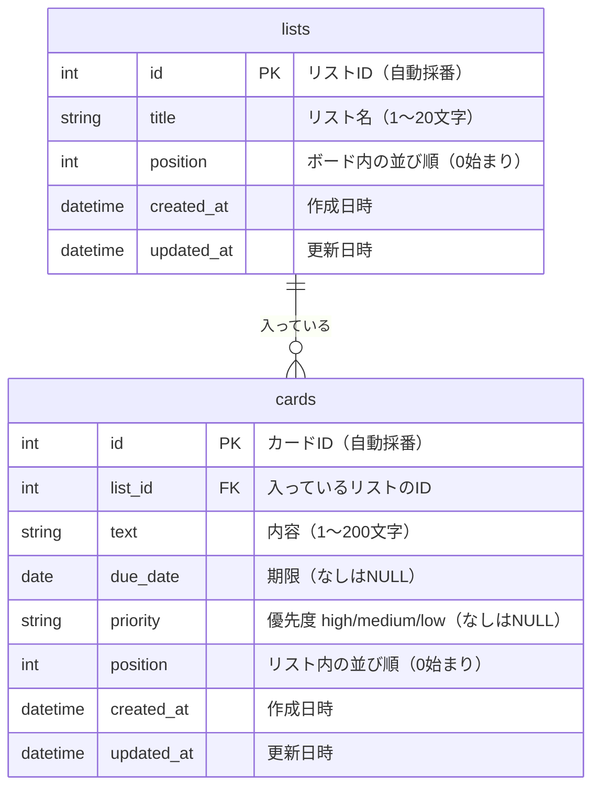

# 要件定義書 ④ システム構成・データ設計・API設計

[← 目次・要約に戻る](README.md) ｜ 主に読む人：開発者

---

## 8. システム構成

### 8.1 フェーズ1

```
┌──────────── 自分のパソコン ────────────┐
│  ブラウザ                               │
│  ┌──────────────┐    ┌──────────────┐  │
│  │ 画面          │───→│ localStorage │  │
│  │ (HTML/CSS/JS) │←───│              │  │
│  └──────────────┘    └──────────────┘  │
└────────────────────────────────────────┘
```

### 8.2 フェーズ2

```
┌─────────────────────────── 自分のパソコン ───────────────────────────┐
│  ブラウザ                    バックエンド              データベース      │
│  ┌──────────────┐  API   ┌──────────────┐  SQL   ┌──────────────┐   │
│  │ 画面          │──────→│ サーバー       │──────→│ lists        │   │
│  │ (HTML/CSS/JS) │←──────│ (言語はQ-01)   │←──────│ cards        │   │
│  └──────────────┘  JSON  └──────────────┘        └──────────────┘   │
│      http://localhost:（番号）                                         │
└──────────────────────────────────────────────────────────────────────┘
```

- バックエンドは、APIのほかに画面のファイル（index.html など）も配る。画面とAPIが同じ住所（オリジン）になるので、余計な設定がいらない
- バックエンドは、自分のパソコンからの接続だけを受け付ける（NFR-21）

## 9. データ設計

### 9.1 フェーズ1：localStorage

ボードの中にリストの配列、各リストの中にカードの配列を持つ入れ子構造にします。配列の順番がそのまま画面の並び順になります。

| データ | 項目 | 型 | 説明 |
| --- | --- | --- | --- |
| ボード | version | 数値 | 保存データの形式の版。今回は `1` |
| ボード | lists | 配列 | リストの一覧（並び順どおり） |
| リスト | id | 文字列 | リストを区別するID |
| リスト | title | 文字列 | リスト名（20文字まで） |
| リスト | cards | 配列 | カードの一覧（上から順に） |
| カード | id | 文字列 | カードを区別するID |
| カード | text | 文字列 | タスクの内容（200文字まで） |
| カード | due | 文字列または null | 期限。`"2026-11-25"` の形（年-月-日）。期限がないときは `null`（F-11） |
| カード | priority | 文字列または null | 優先度。`"high"`（高）・`"medium"`（中）・`"low"`（低）のどれか。ないときは `null`（F-12） |

データを丸ごとJSON文字列にして、localStorageの `taskBoard` という名前で保存します。初めて開いたときのデータは次のとおりです。

```json
{
  "version": 1,
  "lists": [
    { "id": "l1", "title": "ToDo", "cards": [] },
    { "id": "l2", "title": "進行中", "cards": [] },
    { "id": "l3", "title": "完了", "cards": [] }
  ]
}
```

- **版番号**：`version` は、将来カードにラベルなどの項目を追加したときに、古い形式のデータを見分けて変換するために持つ
- **容量**：localStorageに保存できる量は、およそ5MBまで。カード1枚は最大でも1KB程度なので、想定する上限の1,000枚でも1MB程度に収まる。保存に失敗したときは画面にメッセージを出す
- **壊れたデータ**：保存データが壊れていて読み込めないときは、壊れたデータを `taskBoard_broken` という別の名前で残してから、最初の3つのリストの状態で始める。そのまま初期状態で始めると、次の保存で壊れたデータが上書きされ、あとから調べたり手で直したりできなくなるため

### 9.2 フェーズ2：データベース

リストとカードを、それぞれ別のテーブルに保存します。カードは「どのリストに入っているか」を `list_id` で持ちます。並び順は `position`（0から始まる番号）で持ちます。

#### ER図



図の読み方：`||--o{` は「リスト1つに対して、カードが0枚以上」という意味です。PKは主キー（行を区別する番号）、FKは外部キー（ほかのテーブルの行を指す番号）です。

ボードは1枚だけ（複数ボードは作らない）なので、ボードのテーブルは作りません。

#### テーブル定義

**lists（リスト）**

| 列 | 型 | 必須 | 制約・説明 |
| --- | --- | --- | --- |
| id | 整数 | ○ | 主キー。自動で番号を振る |
| title | 文字列 | ○ | 1〜20文字 |
| position | 整数 | ○ | ボード内の並び順。0から始まる |
| created_at | 日時 | ○ | 作成した日時。自動で入れる |
| updated_at | 日時 | ○ | 最後に変更した日時。自動で入れる |

**cards（カード）**

| 列 | 型 | 必須 | 制約・説明 |
| --- | --- | --- | --- |
| id | 整数 | ○ | 主キー。自動で番号を振る |
| list_id | 整数 | ○ | 外部キー（lists.id）。**リストを削除すると、中のカードも一緒に削除する**（F-04） |
| text | 文字列 | ○ | 1〜200文字 |
| due_date | 日付 | | 期限（F-11）。期限がないときは空（NULL） |
| priority | 文字列 | | 優先度（F-12）。`high`・`medium`・`low` のどれかだけ入れられる。ないときは空（NULL） |
| position | 整数 | ○ | リスト内の並び順。0から始まる |
| created_at | 日時 | ○ | 作成した日時。自動で入れる |
| updated_at | 日時 | ○ | 最後に変更した日時。自動で入れる |

#### 初期データ

テーブルを**最初に作ったときだけ**、「ToDo」「進行中」「完了」の3つのリストを入れます。

「リストが0件なら3つ入れる」という作りにはしません。F-04でリストを全部消してよいことにしているため、そうすると、全部消して再起動したときに3つのリストが勝手に復活してしまいます。

#### 並び順の更新

カードを移動したときは、移動元と移動先のリストのカードについて `position` を振り直します。期限順・優先度順に並べ替えたとき（F-13）は、そのリストのカードについて `position` を振り直します。どちらも、途中で失敗して並び順が中途半端にならないよう、まとめて1つのトランザクションで行います。

### 9.3 フェーズ1からフェーズ2へのデータ移行

**移行しません。** フェーズ2は、最初の3つのリストの状態から始めます。

理由：フェーズ1（ダブルクリックで開く）とフェーズ2（`http://localhost` で開く）ではオリジンが違うため、フェーズ2の画面からフェーズ1のlocalStorageを読むことができません（11.2）。移行するには、データをファイルに書き出して読み込む機能が別に必要になり、今回の範囲を超えます。

## 10. API設計（フェーズ2）

画面とバックエンドは、JSON形式でやりとりします。名前の付け方は、APIでは `listId` のようなキャメルケース、データベースでは `list_id` のようなスネークケースにします。

| No | メソッド | URL | 用途 | 送るデータ | 成功時の返事 |
| --- | --- | --- | --- | --- | --- |
| API-01 | GET | `/api/board` | ボード全体を読み込む | なし | 200：ボード全体（下の例） |
| API-02 | POST | `/api/lists` | リストを追加する | `{"title": "保留"}` | 201：追加したリスト |
| API-03 | PATCH | `/api/lists/{id}` | リスト名を変更する | `{"title": "やること"}` | 200：変更後のリスト |
| API-04 | DELETE | `/api/lists/{id}` | リストを削除する（中のカードも） | なし | 204：返事の中身なし |
| API-05 | POST | `/api/lists/{id}/cards` | カードを一番下に追加する | `{"text": "買い物"}` | 201：追加したカード |
| API-06 | PATCH | `/api/cards/{id}` | カードの内容・期限・優先度を変更する | `{"text": "買い物に行く"}`、`{"dueDate": "2026-11-25"}`、`{"priority": "high"}` など | 200：変更後のカード |
| API-07 | DELETE | `/api/cards/{id}` | カードを削除する | なし | 204：返事の中身なし |
| API-08 | PUT | `/api/cards/{id}/position` | カードを移動・並べ替えする | `{"listId": 2, "position": 0}` | 200：移動後のカード |
| API-09 | POST | `/api/lists/{id}/sort` | リストの中のカードを期限順・優先度順に並べ替える（F-13） | `{"by": "dueDate"}` または `{"by": "priority"}` | 200：並べ替えた後のリスト（カードを並び順どおりに含む） |

- API-06 は、送った項目だけを変える。期限・優先度を外すときは `null` を送る（例：`{"dueDate": null}`）
- API-08の `position` は、移動先のリストで上から何番目に置くか（0始まり）です。
- API-09 の並べ方のルールは F-13 に従う

**API-01の返事の例**（リストもカードも並び順どおりに並べて返す）

```json
{
  "lists": [
    {
      "id": 1,
      "title": "ToDo",
      "cards": [
        { "id": 10, "text": "要件定義を書く", "dueDate": "2026-11-18", "priority": "high" },
        { "id": 11, "text": "画面を作る", "dueDate": null, "priority": null }
      ]
    },
    { "id": 2, "title": "進行中", "cards": [] },
    { "id": 3, "title": "完了", "cards": [] }
  ]
}
```

**エラーの返事**

| 状態コード | どんなとき | 例 |
| --- | --- | --- |
| 400 | 送られたデータがルールに合わない | 空のタイトル、201文字のカード、存在しない日付（2026-02-30）、優先度に `"urgent"` |
| 404 | 指定したリスト・カードがない | 削除済みのカードIDを指定した |
| 500 | サーバーの中で予期しないエラーが起きた | データベースのファイルが読めない |

エラーのときは `{"error": "カードは200文字以内で入力してください"}` のように、理由を返します。

**画面側の扱い**：保存（APIの呼び出し）に失敗したら、画面右上に赤い文字でメッセージを出し、API-01でボードを読み込み直して、データベースの本当の状態を表示します。

---

[← 前：③ 機能と画面](03-functions-screens.md) ｜ [目次](README.md) ｜ [次：⑤ 非機能要件・運用・技術 →](05-nfr-operations-tech.md)
