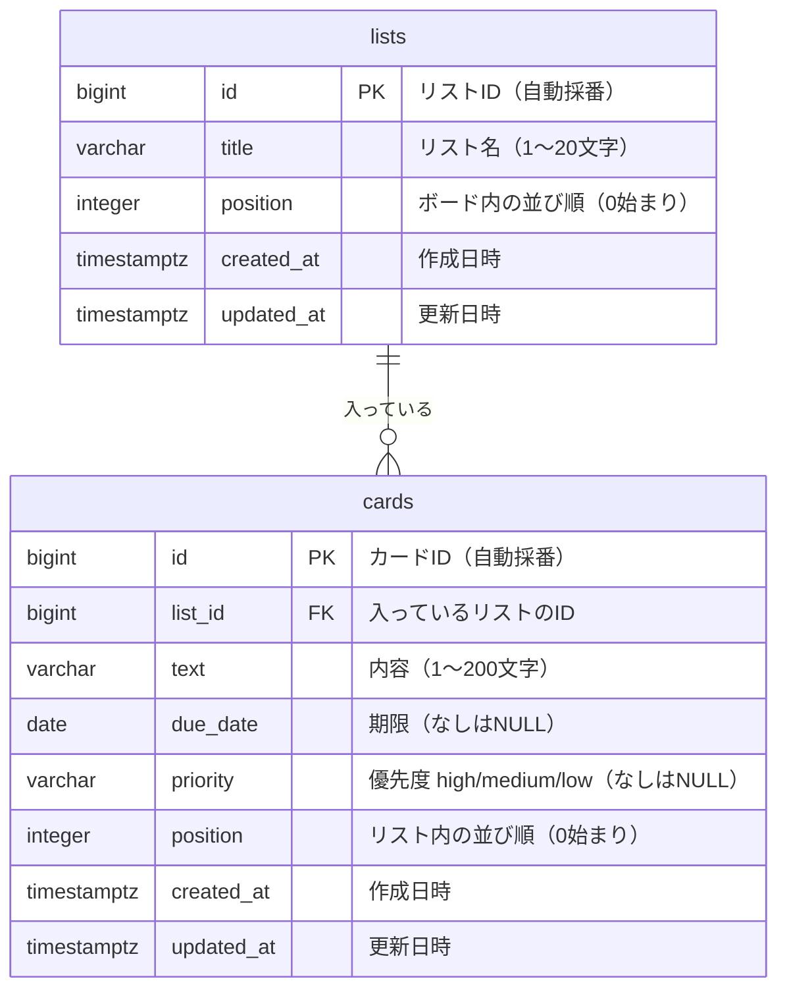

# 要件定義書 ④ システム構成・データ設計・API設計

[← 目次・要約に戻る](README.md) ｜ 主に読む人：開発者

---

## 8. システム構成

### 8.1 ふだん使うとき

```
┌─────────────────────────────── 自分のパソコン ───────────────────────────────┐
│  ブラウザ                     バックエンド                データベース          │
│  ┌──────────────┐  API    ┌──────────────────┐  SQL   ┌──────────────────┐  │
│  │ 画面          │──────→│ Spring Boot       │──────→│ PostgreSQL        │  │
│  │ (React)       │←──────│ (Java 25)         │←──────│  lists / cards    │  │
│  └──────────────┘  JSON   │ 画面のファイルも配る│        └──────────────────┘  │
│                           └──────────────────┘          ポート 5432           │
│      http://localhost:8080                                                     │
└────────────────────────────────────────────────────────────────────────────┘
```

- 画面は、Vite でビルドしたファイル（HTML・CSS・JavaScript）を Spring Boot が配る。画面とAPIが同じオリジン（`http://localhost:8080`）になるので、余計な設定（CORS）がいらない
- バックエンドとデータベースは、自分のパソコンからの接続だけを受け付ける（NFR-21）
- PostgreSQL は Windows のサービスとして、パソコンの起動と一緒に動き出す

### 8.2 開発しているとき

画面を書き換えるたびにビルドするのは手間なので、開発中は Vite の開発サーバーで画面を表示します。書き換えるとすぐ画面に反映されます。

```
  ブラウザ ──→ Vite開発サーバー (http://localhost:5173)
                 │  画面のファイル：その場で変換して返す
                 │  /api で始まる依頼：バックエンドへ中継する
                 ↓
               Spring Boot (http://localhost:8080) ──→ PostgreSQL
```

`/api` をバックエンドへ中継（プロキシ）するので、画面のプログラムは「ふだん使うとき」と同じURL（`/api/...`）のままで動きます。

## 9. データ設計

リストとカードを、それぞれ別のテーブルに保存します。カードは「どのリストに入っているか」を `list_id` で持ちます。並び順は `position`（0から始まる番号）で持ちます。

### 9.1 ER図



図の読み方：`||--o{` は「リスト1つに対して、カードが0枚以上」という意味です。PKは主キー（行を区別する番号）、FKは外部キー（ほかのテーブルの行を指す番号）です。

ボードは1枚だけ（複数ボードは作らない）なので、ボードのテーブルは作りません。

### 9.2 テーブル定義

型は PostgreSQL の型で書いています。PostgreSQL の `varchar(20)` は「20文字まで」で、日本語も1文字として数えます。

**lists（リスト）**

| 列 | 型 | 必須 | 制約・説明 |
| --- | --- | --- | --- |
| id | bigint | ○ | 主キー。自動で番号を振る（`GENERATED ALWAYS AS IDENTITY`） |
| title | varchar(20) | ○ | 1〜20文字。空文字は入れられない（CHECK制約） |
| position | integer | ○ | ボード内の並び順。0から始まる |
| created_at | timestamptz | ○ | 作成した日時。自動で入れる |
| updated_at | timestamptz | ○ | 最後に変更した日時。自動で入れる |

**cards（カード）**

| 列 | 型 | 必須 | 制約・説明 |
| --- | --- | --- | --- |
| id | bigint | ○ | 主キー。自動で番号を振る |
| list_id | bigint | ○ | 外部キー（lists.id）。**リストを削除すると、中のカードも一緒に削除する**（`ON DELETE CASCADE`、F-04） |
| text | varchar(200) | ○ | 1〜200文字。空文字は入れられない（CHECK制約） |
| due_date | date | | 期限（F-11）。期限がないときは空（NULL） |
| priority | varchar(6) | | 優先度（F-12）。`high`・`medium`・`low` のどれかだけ入れられる（CHECK制約）。ないときは空（NULL） |
| position | integer | ○ | リスト内の並び順。0から始まる |
| created_at | timestamptz | ○ | 作成した日時。自動で入れる |
| updated_at | timestamptz | ○ | 最後に変更した日時。自動で入れる |

`cards` には、「あるリストのカードを並び順に取り出す」処理を速くするため、`(list_id, position)` に索引（インデックス）を付けます。

### 9.3 テーブルの作り方と初期データ

テーブルは Flyway のマイグレーションで作ります。SQLファイルに番号を付けて `backend/src/main/resources/db/migration/` に置くと、サーバーの起動時に、まだ実行していないファイルだけが順に実行されます。

| ファイル | 内容 |
| --- | --- |
| `V1__create_tables.sql` | `lists`・`cards` テーブルを作る |
| `V2__insert_initial_lists.sql` | 「ToDo」「進行中」「完了」の3つのリストを入れる |

V2 は**最初の1回しか実行されない**ので、初期データは「テーブルを最初に作ったときだけ」入ります。

「リストが0件なら3つ入れる」という作りにはしません。F-04でリストを全部消してよいことにしているため、そうすると、全部消して再起動したときに3つのリストが勝手に復活してしまいます。

テーブルの形をあとから変えるときは、すでにあるファイルは書き換えず、`V3__...sql` のように新しいファイルを足します。

### 9.4 並び順の更新

カードを移動したときは、移動元と移動先のリストのカードについて `position` を振り直します。期限順・優先度順に並べ替えたとき（F-13）は、そのリストのカードについて `position` を振り直します。どちらも、途中で失敗して並び順が中途半端にならないよう、まとめて1つのトランザクションで行います（Spring の `@Transactional`）。

## 10. API設計

画面とバックエンドは、JSON形式でやりとりします。名前の付け方は、APIでは `listId` のようなキャメルケース、データベースでは `list_id` のようなスネークケースにします。

| No | メソッド | URL | 用途 | 送るデータ | 成功時の返事 |
| --- | --- | --- | --- | --- | --- |
| API-01 | GET | `/api/board` | ボード全体を読み込む | なし | 200：ボード全体（下の例） |
| API-02 | POST | `/api/lists` | リストを追加する | `{"title": "保留"}` | 201：追加したリスト |
| API-03 | PATCH | `/api/lists/{id}` | リスト名を変更する | `{"title": "やること"}` | 200：変更後のリスト |
| API-04 | DELETE | `/api/lists/{id}` | リストを削除する（中のカードも） | なし | 204：返事の中身なし |
| API-05 | POST | `/api/lists/{id}/cards` | カードを一番下に追加する | `{"text": "買い物"}` | 201：追加したカード |
| API-06 | PATCH | `/api/cards/{id}` | カードの内容・期限・優先度を変更する | `{"text": "買い物に行く"}`、`{"dueDate": "2026-11-25"}`、`{"priority": "high"}` など | 200：変更後のカード |
| API-07 | DELETE | `/api/cards/{id}` | カードを削除する | なし | 204：返事の中身なし |
| API-08 | PUT | `/api/cards/{id}/position` | カードを移動・並べ替えする | `{"listId": 2, "position": 0}` | 200：移動後のカード |
| API-09 | POST | `/api/lists/{id}/sort` | リストの中のカードを期限順・優先度順に並べ替える（F-13） | `{"by": "dueDate"}` または `{"by": "priority"}` | 200：並べ替えた後のリスト（カードを並び順どおりに含む） |

- API-06 は、送った項目だけを変える。期限・優先度を外すときは `null` を送る（例：`{"dueDate": null}`）。「項目を送らなかった」と「`null` を送った」を区別する必要があるので、作るときに注意する
- API-08の `position` は、移動先のリストで上から何番目に置くか（0始まり）です。
- API-09 の並べ方のルールは F-13 に従う
- `/api` で始まらないURLには、画面のファイルを返す

**API-01の返事の例**（リストもカードも並び順どおりに並べて返す）

```json
{
  "lists": [
    {
      "id": 1,
      "title": "ToDo",
      "cards": [
        { "id": 10, "text": "要件定義を書く", "dueDate": "2026-11-18", "priority": "high" },
        { "id": 11, "text": "画面を作る", "dueDate": null, "priority": null }
      ]
    },
    { "id": 2, "title": "進行中", "cards": [] },
    { "id": 3, "title": "完了", "cards": [] }
  ]
}
```

**エラーの返事**

| 状態コード | どんなとき | 例 |
| --- | --- | --- |
| 400 | 送られたデータがルールに合わない | 空のタイトル、201文字のカード、存在しない日付（2026-02-30）、優先度に `"urgent"` |
| 404 | 指定したリスト・カードがない | 削除済みのカードIDを指定した |
| 500 | サーバーの中で予期しないエラーが起きた | データベースにつながらない |

エラーのときは `{"error": "カードは200文字以内で入力してください"}` のように、理由を返します。エラーの返事の形は、1か所（Spring の `@RestControllerAdvice`）でそろえます。

**画面側の扱い**：保存（APIの呼び出し）に失敗したら、画面右上に赤い文字でメッセージを出し、API-01でボードを読み込み直して、データベースの本当の状態を表示します。

---

[← 前：③ 機能と画面](03-functions-screens.md) ｜ [目次](README.md) ｜ [次：⑤ 非機能要件・運用・技術 →](05-nfr-operations-tech.md)
